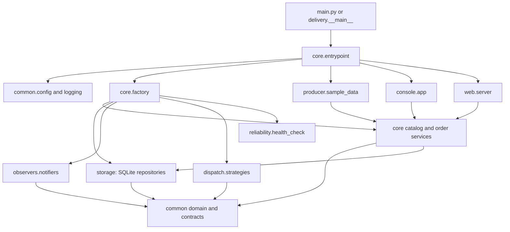

# Architecture

See [README](../README.md) for commands and the interactive workflow.

## Application overview

The `delivery` package is a layered console application. `core.entrypoint` configures
logging and calls `core.factory.build_app()`, which opens the SQLite database,
restores every saved customer, restaurant, courier and order into one shared
`LoadedData`, and creates observers and services. Sample data enters through
CatalogService and is skipped when already saved. ConsoleApp (or the web page
through `web.server`) sends operations
to OrderService, which builds orders, attaches observers, selects couriers,
invokes state transitions and saves each change in one transaction through the
SQL repositories. Notifications collect messages for display; no SMS or email
is sent. EventLogObserver starts from the event counts saved in `order_events`.

An order moves from NEW to ASSIGNED to PICKED_UP to DELIVERED. Cancellation is
allowed from NEW or ASSIGNED. Dispatch selects only free couriers; waiting orders
are considered in insertion order. Delivery releases the courier and moves them
to the customer's location. Cancellation releases them without moving them.
HealthCheck checks consistency between orders and couriers and nonnegative prices.

## Dependency flow



The composition factory alone constructs and connects concrete dependencies.
Each call to `build_app()` creates independent repository and observer instances.
Services accept those dependencies through constructors and do not construct
storage. The console receives the resulting context. Domain objects do not import
console, services or storage. Configuration and logging share the `common` package
but are used at startup, not by domain policy. Sample data has its own module and
is optional when constructing an application programmatically.

```python
from delivery.core.factory import build_app
from delivery.producer.sample_data import load_sample_data

app = load_sample_data(build_app("fastest"))
order = app.order_service.place_order("C1", "R1", [("Pizza", 1)])
app.order_service.dispatch_order(order.id)
app.order_service.pick_up(order.id)
app.order_service.deliver(order.id)
assert app.health.is_healthy()
```

## Design patterns

| Pattern | Implementation | Runtime role |
| --- | --- | --- |
| Builder | `common/builders.py`: OrderBuilder, RestaurantBuilder | Stepwise construction and validation |
| Factory Method | `common/couriers.py`: CourierCreator and concrete creators | `hire()` delegates courier creation to a subclass |
| Abstract Factory | `common/delivery_options.py`: StandardDeliveryFactory, ExpressDeliveryFactory | Matching price calculator and cooking-time estimator |
| Template Method | `dispatch/strategies.py`: Dispatcher.dispatch | Fixes candidate filtering, selection and assignment; subclasses choose |
| Observer | `common/observer.py`, `observers/notifiers.py` | Order broadcasts lifecycle changes to customer, restaurant and event-log observers |
| State | `common/order_states.py`, `common/order.py` | Order delegates permitted actions to its current state object |
| Repository | `storage/*_repository.py` | Encapsulates SQLite tables and queries |
| Dependency injection | `core/factory.py` and service constructors | Application owns resources and supplies dependencies |

Nearest and fastest selection are interchangeable policies implemented using
Template Method inheritance. `build_app()` is a composition helper, not an
additional claim of the GoF Factory Method pattern. Singleton, Command and remote Proxy are not implemented in this version.
Encapsulation, abstract base classes, inheritance and polymorphism are used
throughout the domain model.

## Startup and responsibility boundaries

`main.py` and `python3 -m delivery` both call `core.entrypoint.main()`. Startup
parses arguments through `common.config`, configures logging, constructs an
AppContext (which restores everything saved), adds any missing sample records,
and runs the scripted demo, the menu or the web page. The demo always uses a
fresh in-memory database; the menu and web page continue from `data/delivery.db`.

| Responsibility | Owner |
| --- | --- |
| Input parsing and displaying orders/couriers | `console.app.ConsoleApp`, `web.server.WebApi` |
| Which actions an order offers (web buttons) | `common.order_states` (`actions`, `is_final`) |
| Registering sample customers, restaurants and couriers | `producer.sample_data` through `core.catalog_service` |
| Placing, dispatching, picking up, delivering and cancelling | `core.order_service.OrderService` |
| Selecting a free courier | `dispatch.strategies.Dispatcher` subclasses |
| Permitted order transitions | `common.order_states` |
| Courier availability, final location and delivery count | `common.couriers` coordinated by OrderService |
| Saving and restoring data (SQLite) | `storage` repositories, `DataLoader`, `TransactionManager` |
| Customer/restaurant messages and event counts | `observers.notifiers` |
| Runtime consistency inspection | `reliability.health_check` |

## Assignment and lifecycle semantics

The menu is an operator interface, not a driver login. Choosing option 3 dispatches
all waiting NEW orders in insertion order. The configured policy selects an
available courier automatically. The operator cannot enter a courier ID to choose
or replace that assignment through the menu; OrderService likewise has no public
manual-assignment use case taking both an order ID and courier ID.

Option 4 records pickup of the selected order by its already assigned courier.
Option 5 records delivery by that same courier. Both take an order number, not a
courier ID. They are immediate recorded actions: there is no movement simulation,
background timer or automatic completion based on the estimated arrival time.

```text
NEW --dispatch--> ASSIGNED --pickup--> PICKED_UP --deliver--> DELIVERED
 |                  |
 +----cancel--------+-------------------------------------> CANCELLED
```

Each courier carries one order. Delivery frees the courier, increments their
delivery count, and moves their location to the customer's location. Cancelling
an assigned order frees its courier without moving them or increasing their
count. Freeing a courier does not automatically dispatch the next order: the
operator must select option 3 again. Standard/express affects pricing and cooking
time; it does not prioritize the dispatch queue.

## Saving, restoring and notifications

All entity data is saved in SQLite (`data/delivery.db` for the menu; the demo
and the tests use a throwaway in-memory database). At startup the saved data is
loaded once; services then work on those objects and save each change:

1. OrderService opens a transaction and changes the order (and its courier).
   The order only records its event; observers are not told yet.
2. The change is written through the repositories and committed.
3. After the commit, the recorded events are announced with `order.notify`.

If anything fails before the commit, the database rolls back. Python objects do
not roll back, so they are discarded and loaded again from the database, and
the recorded events are dropped: observers never hear about unsaved changes.
Restoring an order never emits events; restored orders get the observers
attached and hear only about later actions. A failing observer is logged and
skipped, so it cannot stop the other observers or undo the saved change.

Events are delivered **at most once**. If the app crashes after a commit but
before announcing, the change is saved but its messages are never shown; event
counts are still correct after the next start because they are read from
`order_events`. A durable outbox (an "announced" flag on `order_events`) would
be needed for at-least-once delivery once real SMS or email is sent.

Health checks inspect a limited set of invariants, not all possible application
errors.
